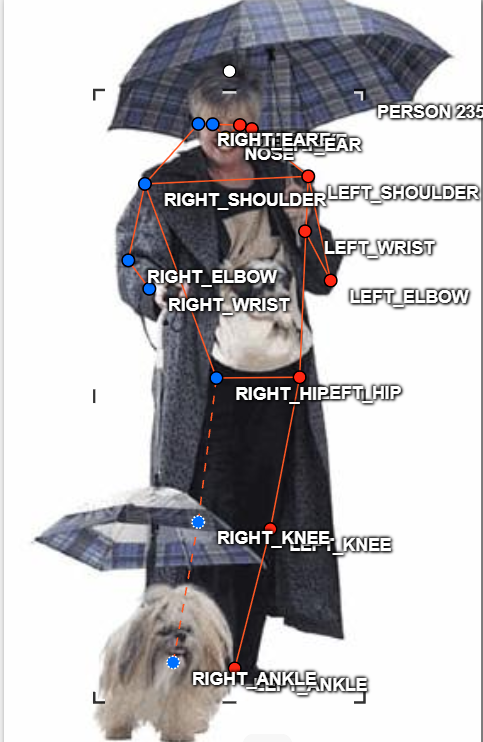
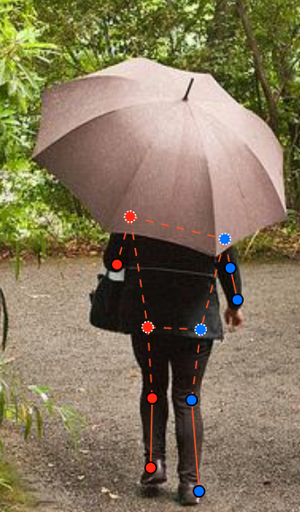
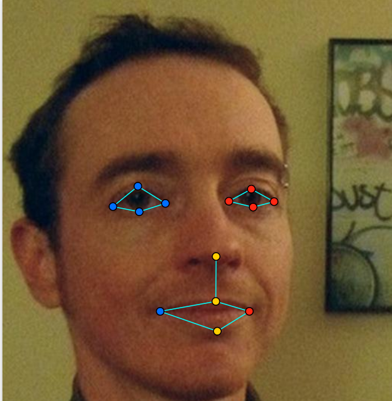
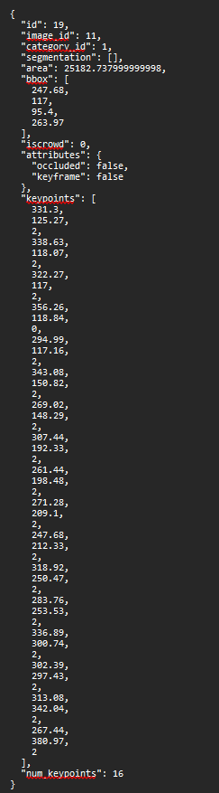

# Báo cáo cá nhân — HoVaTen-MSSV

Đổi tên file theo quy tắc `MSSV_HoTen.md`. Ví dụ: `20241234_NguyenVanAn.md`.

Dữ liệu: 12 ảnh người COCO val2017 (Lin et al., 2014) và 8 ảnh chân dung Wikimedia Commons, chỉ dùng trong lớp.

## 0. Thông tin học viên

- Họ tên: Nguyễn Hán Trường Giang
- MSSV: 2A202603112
- Email: 26ai.giangnht@vinuni.edu.vn
- Link repository: https://github.com/giangnht29032004/K5-L2-DAY04-NguyenHanTruongGiang-2A202603112-KeypointPose
- Phiên bản CVAT (Help → About): 2.74.1
- Máy: hệ điều hành Windows · RAM 16 GB · chạy CVAT chế độ đầy đủ
- Bộ ảnh (`src/exports/assignment.json` do `lab.py setup` tạo): có
- Giờ bắt đầu:16 giờ 40 phút
- Giờ kết thúc: 18 giờ 20 phút

## 1. Kiểm tra label (CP0)

| Label | Kiểu | Số điểm | Tên điểm đúng bảng của lab? | Đúng thứ tự? | Số cạnh |
|---|---|---:|---|---|---:|
| `person` |Skeleton |17 |Có |Có |19 |
| `face` |Skeleton |13 |Có |Có |13 |

Mẫu `person` dựng theo người quay mặt về camera (các điểm `left_*` nằm bên phải khung mẫu)? Có 

Cách đổi cờ `occluded` / `outside` cho **một điểm** trên phiên bản CVAT này (một câu):

Nhấn Q đổi cờ 'occluded', nhấn O đổi cờ 'outside'.

## 2. Số lượng đã gán và thời gian (CP1, CP2)

| Nhóm ảnh | Số ảnh | Số skeleton đã gán | Số người dưới 60 px (không gán) | Số poster / gương / màn hình bỏ qua | Thời gian (phút) |
|---|---:|---:|---:|---:|---:|
| `easy` | 5 |5 |0 |0 |30 |
| `occluded` | 3 |5 |0 |0 |20 |
| `back` | 2 |4 |0 |0 | 10|
| `small` | 1 | 3| 0| 0| 5|
| `crowd` | 1 | 3| 0| 0| 5|
| `faces` | 8 | 8| — | | |

- Số ảnh người đã xong ở mốc phút 105: 10 / 10
- Thời gian thực tế (phút): CP1 60 · CP2 30 · CP3 20
- Ảnh tốn thời gian nhất là ảnh nào, vì sao?

Ảnh tốn thời gian nhất: 000000012552.jpg. Vì có 2 người quay lưng lại và 1 người thì đan chéo tay nhau rất khó để đánh skeleton.

## 3. Bảng ca khó (CP1, CP2)

Mỗi điểm bạn phân vân một dòng, nhất là phân vân giữa `v = 1` và `v = 0`, hoặc không chắc hướng người.

| Ảnh | Người / mặt | Điểm | Cờ đã chọn | Phân vân giữa | Lý do chọn |
|---|---|---|---:|---|---|
|face_256814.jpg |Mặt |Mắt sau kính râm người đàn ông |'v=0'|'v = 1' và 'v=0' |Do không chắc chắn mắt người đó ở đâu |
| | | | | | |
| | | | | | |

## 4. Bảng tự review (CP3)

Đi từ ảnh cuối về ảnh đầu. 5 ảnh người (ít nhất 2 ảnh `back` hoặc `crowd`) và 3 ảnh mặt. Ít nhất 8 dòng, kể cả dòng `ok`. Ghi lỗi trước, sửa sau.

Mã lỗi dùng đúng một trong: `lr_swap`, `vis_flag`, `position`, `missing`, `extra`, `ok`.

| Ảnh | Người / mặt | Điểm | Mã lỗi | Ghi chú | Đã sửa? |
|---|---|---|---|---|---|
| | | | | | |
| | | | | | |
| | | | | | |
| | | | | | |
| | | | | | |
| | | | | | |
| | | | | | |
| | | | | | |

Tổng hợp số lỗi theo mã:

| `lr_swap` | `vis_flag` | `position` | `missing` | `extra` | `ok` |
|---:|---:|---:|---:|---:|---:|
| | | | | | |

Điểm còn phân vân giữa `v = 1` và `v = 0` (ghi cả hai lựa chọn và lý do chọn):

...

## 5. Kiểm file xuất và kết quả tự kiểm (CP4)

Tự kiểm tay trong file JSON:

| File | Người / mặt kiểm (ảnh, thứ tự) | Số phần tử `keypoints` | Điểm `outside` ra `v = 0`, `occluded` ra `v = 1`? | `num_keypoints` khớp? |
|---|---|---:|---|---|
| `NguyenHanTruongGiang_persons.zip` |000000012552.jpg, annotation #1 |51 |Có (v=0: 4 điểm; v=1: 5 điểm) |Có (num_keypoints=13) |
| `NguyenHanTruongGiang_persons.zip` |000000150192.jpg, annotation #8 |51 |Có (v=0: 6 điểm; v=1: 2 điểm) |Có (num_keypoints=11) |
| `NguyenHanTruongGiang_faces.zip` |face_256814.jpg, annotation #4 |39 |	outside ra v=0; hiện không có điểm v=1 |Có (num_keypoints=5) |

Sau khi xuất, CVAT ghi `occluded` thành `v = 1` và `outside` thành `v = 0`. Tọa độ của điểm `outside` trong file là `0, 0` hay tọa độ cũ? tọa độ cũ

Hai job đã chuyển sang completed trên CVAT? Có.

Dán phần **TÓM TẮT** in ra từ `src/check_submission.py`:

```text
----- TÓM TẮT (dán vào báo cáo mục 5) -----
- File person: NguyenHanTruongGiang_persons.zip
  Số ảnh: 12 · số skeleton `person`: 20 · mỗi annotation 51 số
  Skeleton theo ảnh: 000000012552=3, 000000030960=2, 000000054909=2, 000000150192=3, 000000150500=1, 000000177338=2, 000000184224=1, 000000210604=2, 000000220045=1, 000000294329=1, 000000390585=1, 000000429594=1
  Cờ v: v=2 232 (68%) · v=1 42 (12%) · v=0 66 (19%)
  num_keypoints trung bình: 13.7
- File face: NguyenHanTruongGiang_faces.zip
  Số ảnh: 8 · số skeleton `face`: 8 · mỗi annotation 39 số
  Skeleton theo ảnh: face_125051=1, face_143959=1, face_204787=1, face_256814=1, face_53580=1, face_560282=1, face_575921=1, face_79591=1
  Cờ v: v=2 96 (92%) · v=1 0 (0%) · v=0 8 (8%)
  num_keypoints trung bình: 12.0
- Ghi chú: 74 điểm v = 0 vẫn mang tọa độ cũ (CVAT 2.x xuất như vậy; chuẩn COCO ghi 0, 0). Không phải lỗi: điểm v = 0 bị bỏ qua khi huấn luyện và khi chấm.
- Số [LỖI]: 0 · số [CẢNH BÁO]: 2
Kết quả: ĐẠT (đọc lại từng cảnh báo ở trên)
```

Các `[CẢNH BÁO]` còn giữ nguyên và lý do:

  [CẢNH BÁO] 000000012552.jpg #2: cặp shoulder nằm ngược phía so với các cặp còn lại. Có thể đổi trái/phải một cặp (`lr_swap`), hoặc tay / chân bắt chéo thật: kiểm lại.
  [CẢNH BÁO] 000000150192.jpg #3: các điểm chỉ trải cao 26 px (< 60 px). Người dưới 60 px không gán; nếu người cao hơn nhưng bị cắt khung thì bỏ qua cảnh báo này.
Lý do:
 - Cảnh báo 1: Người đó đang đánh bóng chày và tay chân vắt chéo tay, tôi đã đánh dấu đúng theo yêu cầu có thể cảnh báo bị lỗi.
 - Cảnh báo 2: Người trong ảnh đang ngồi nên chỉ cao 26px chứ không phải bị cắt ảnh.

## 6. Ảnh chụp màn hình

1. Label `person` trong label constructor (đủ 17 điểm có tên):

   

2. Một người quay lưng đã gán, cờ đã đặt:

   

3. Một khuôn mặt đã gán 13 điểm, phóng to vùng mắt:

   

4. Một đoạn JSON xuất của một người:

   

Nguồn ảnh: COCO val2017 / Wikimedia Commons.

## 7. Tự đánh giá

1. Lỗi bạn mắc nhiều nhất hôm nay, và cách bạn sẽ tránh ở dự án thật:

   Không mắc lỗi khi gán nhãn.

2. Một quy tắc bạn đề xuất thêm vào guideline (kèm ảnh ví dụ nếu có):

   Không.

3. Nhãn của bạn đi vào model ở đâu? Chọn một lỗi bạn đã sửa và nói nó sẽ làm model học sai thế nào (heatmap, trọng số trong loss, hay bước lật ảnh):

   Nhãn keypoint của em được đưa vào mô hình để tạo heatmap biểu diễn vị trí các điểm khớp, đồng thời xác định trọng số tính loss dựa trên trạng thái hiển thị của từng điểm;
   Không có lỗi đã sửa.

## 8. Khó khăn và lỗi kỹ thuật

Không.

## Bonus (nếu làm)

### B1 — 3 ảnh người khó thêm

| Ảnh | Số skeleton | Số người dưới 60 px | Ca khó nhất |
|---|---:|---:|---|
| | | | |
| | | | |
| | | | |

Kết quả `src/check_submission.py` cho `HoVaTen_bonus_persons.zip`:

```text
(dán ở đây)
```

### B2 — 5 ảnh khuôn mặt đen trắng / hồng ngoại

Ảnh không màu khó hơn ở điểm nào? Kính râm trên ảnh hồng ngoại có còn là `v = 1` không?

...

### B3 — Model so với nhãn của tôi (không tính điểm)

- Demo đã dùng:
- Ảnh đã thử:

1. Model có trả điểm cho khớp bị che, hay khớp ngoài ảnh không? Confidence ở các điểm đó thế nào?

   ...

2. Với người quay lưng, model có đổi trái/phải không?

   ...

3. Bộ điểm của model có giống 17 điểm COCO không?

   ...

## 9. Tài liệu tham khảo và công cụ AI đã dùng

...
